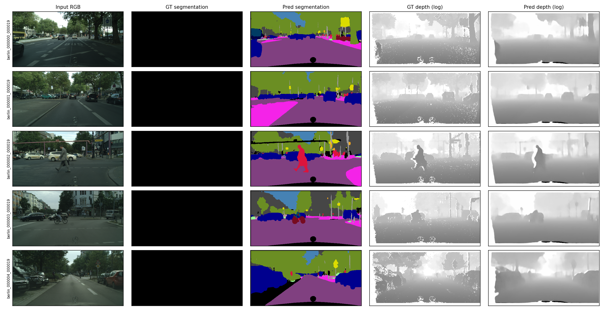

# Multi-task Semantic Segmentation & Depth Estimation: Inference Testing

Inference-only testing of a multi-task CNN (**ResUNet-MTL**) that predicts a 20-class semantic segmentation map and a dense depth map from a single RGB image, on a 5-image subset of the [Cityscapes](https://www.cityscapes-dataset.com/) dataset.

**Report:** [`Anugrah Putra Al Fatih_26590120PPA07385_Report_Inference_MTL_Seg_Depth.pdf`](Anugrah%20Putra%20Al%20Fatih_26590120PPA07385_Report_Inference_MTL_Seg_Depth.pdf)



## Model
- Shared **ResNet-34** encoder and two U-Net-style decoders (skip connections, bilinear upsampling)
- Segmentation head: 20 channels + sigmoid. Depth head: 1 channel + ReLU (normalised 0-1 = 0-100 m)
- 27.78 M parameters, input 256x512 (Cityscapes downsampled 4x)

## Results (`trained_model/best_model.pth`)

| Split (city) | IoU (notebook) | mIoU | Pixel acc. | Depth MAE |
|---|---|---|---|---|
| **test (Berlin)** | 0.0411* | n/a | n/a | **0.0603 (about 6.0 m)** |
| val (Frankfurt) | 0.872 | 0.385 | 93.7% | 6.75 m |
| train (Aachen) | 0.933 | 0.613 | 96.7% | 3.65 m |

Test averages: TM = (1 - IoU) + MAE = **1.0192**, inference time about **0.34 s/image** (CPU).

\* Cityscapes test labels are not public: every test `gtFine_labelIds` file is entirely "None", so the test IoU is not a real segmentation score. The val split gives the meaningful held-out estimate.

## Repository contents
| Path | Description |
|---|---|
| `mtl_seg_dep_colab.ipynb` | Original course notebook (Colab) |
| `mtl_seg_dep_local.ipynb` | Local, inference-only copy (see changes below) |
| `mtl_seg_dep_local_executed.ipynb` | The executed local notebook with all outputs |
| `trained_model/test_log.csv` | Per-image test log from the local run |
| `trained_model/test_log_colab_original.csv` | Test log from the original Colab run |
| `resunet_mtl_0/` | Train/val log and model graph of the 2-epoch Colab demo training |
| `inference_results/` | Qualitative figure, summary for all splits, per-class IoU |
| `scripts/` | Build the local notebook, evaluate all splits, build the PDF report |

## How to reproduce
1. Put the Cityscapes subset in `cityscapes/` (`leftImg8bit_trainvaltest/`, `gtFine_trainvaltest/`, `disparity_trainvaltest/`) and the weights in `trained_model/best_model.pth`. Both come from the course Google Drive folder and are not included here (the Cityscapes license forbids redistribution, and the weights exceed GitHub's 100 MB limit).
2. Install: `pip install torch torchvision opencv-python-headless numpy>=2.2.1 pandas matplotlib tqdm ipywidgets nbconvert`
   (numpy 2.2.0 crashes on Windows in `encode_labels` when it compares a uint8 view with `-1`)
3. Run the notebook:
   ```bash
   python scripts/make_local_notebook.py mtl_seg_dep_colab.ipynb mtl_seg_dep_local.ipynb
   jupyter nbconvert --to notebook --execute mtl_seg_dep_local.ipynb --output mtl_seg_dep_local_executed.ipynb
   python scripts/eval_all_splits.py   # optional: metrics on the labelled train/val splits
   ```

### Changes in the local notebook compared to the Colab original
- Google Drive mount removed; `rootdir` points to the local folder
- `device` falls back to CPU; `map_location` added to `torch.load`
- `resnet34(pretrained=False)`: the ImageNet weights are overwritten by `best_model.pth` anyway
- `num_workers=0` (needed on Windows); training, model-graph and TensorBoard cells skipped
- Extra cell saves the qualitative figure of all test images

---
Anugrah Putra Al Fatih · NIM 26/590120/PPA/07385
